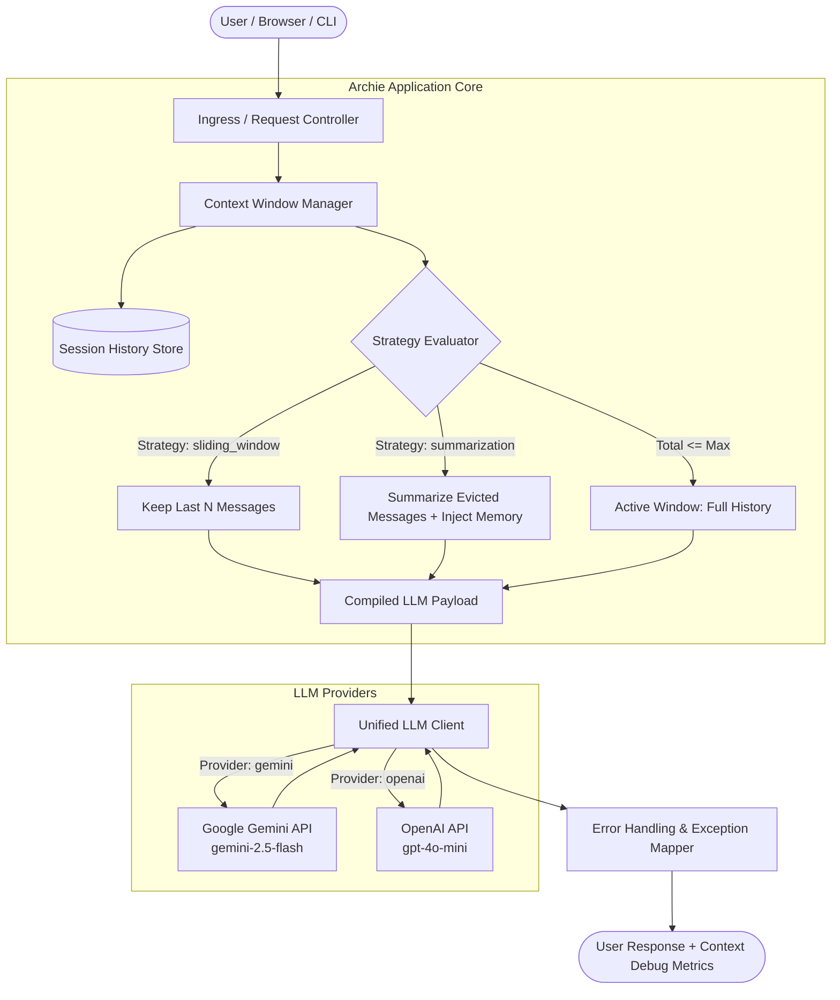

# 🤖 Archie — Multi-Turn LLM Chatbot with Context Management

[](https://python.org)
[](LICENSE)
[]()
[]()

A full-stack, production-grade conversational AI assistant powered by real LLM APIs (**Google Gemini** or **OpenAI**) featuring **active multi-turn memory** and **dynamic context window management** (Sliding Window Truncation and Running Memory Summarization).

---

## 🎯 What This Solves

Standard naive LLM chatbots suffer from two fatal flaws:
1. **Amnesia**: They forget previous messages after a single turn if history isn't sent.
2. **Context Blowup / Token Exhaustion**: If you send infinite history forever, requests quickly exceed context token limits, inflate latency, increase API costs, or trigger hard provider rejections.

**Archie** solves both problems with a robust **Context Manager**:
- Retains genuine multi-turn context so the assistant can accurately reference details from earlier in the dialogue.
- Enforces context window bounds through two configurable strategies: **Sliding Window Truncation** or **Hierarchical Running Summarization**.
- Provides both a **modern Web UI** (with a live Context Inspector drawer) and a **Terminal CLI**.

---

## 📋 Requirements Checklist

| Requirement | Implementation Details | Status |
| :--- | :--- | :---: |
| **Backend Endpoint** | Async REST API (`POST /api/chat`, `GET /api/history`, `POST /api/reset`, `GET /api/health`, `GET /api/config`) | ✅ Complete |
| **Multi-turn History** | Session-based message stores tracking timestamps, speakers, and conversational turns | ✅ Complete |
| **Context Window Management** | Dual-strategy: Sliding Window Truncation (`sliding_window`) and Running Memory Summarization (`summarization`) | ✅ Complete |
| **System Prompt & Persona** | "Archie — Senior Systems Architect & Debugging Mentor" with strict directives, plus selectable presets (Socratic Tutor, Code Reviewer, Tech Companion) | ✅ Complete |
| **Resilient Error Handling** | Granular exception trapping for 401 (Invalid Key), 429 (Rate Limits), Timeouts, Network Drops, and Missing Configuration with helpful user guidance | ✅ Complete |
| **Secret Management** | `.env` file for API keys, excluded via `.gitignore` before first commit; documented `.env.example` | ✅ Complete |
| **Minimal Step 2 Script** | `test_connection.py` sends a single verification message to confirm connectivity before launching | ✅ Complete |
| **Usable Interfaces** | Interactive Web Application (`http://localhost:8000`) and Terminal CLI (`cli.py`) | ✅ Complete |

---

## 🏗️ System Architecture



---

## 🧠 Context Management Strategies Explained

### 1. Sliding Window Truncation (`sliding_window`)
* **How it works**: The context manager retains the defined system prompt and the last $N$ conversational messages (`MAX_HISTORY_MESSAGES`, default 6 messages / 3 full turns).
* **When to use**: Fast, predictable, zero-token overhead for condensation.
* **Trade-off**: Information older than $N$ turns is evicted from the prompt window.

### 2. Running Memory Summarization (`summarization` - Recommended)
* **How it works**: As older turns slide past the active window boundary, the evicted conversation turns are automatically condensed into a concise `running_summary`.
* **Prompt Injection**: Before sending the active window to the LLM, the running memory summary is injected into the context:
  ```
  [SYSTEM MEMORY CONTEXT: Summary of earlier conversation turns]
  - User stated their name is Alex and preferred stack is Rust + PostgreSQL.
  - Architecture chosen: Event-driven microservices with Redis queues.
  [END MEMORY CONTEXT]
  ```
* **Benefit**: The model remembers key facts from turn 1 even when you are on turn 25, while prompt tokens stay strictly bounded!

---

## 🚀 Quick Start

### 1. Clone & Setup Environment

```bash
# Clone the repository
git clone <your-repo-url>
cd llm

# Optional: Create and activate a virtual environment
python -m venv venv
# Windows:
.\venv\Scripts\activate
# Linux/macOS:
source venv/bin/activate

# Install dependencies
pip install -r requirements.txt
```

### 2. Configure Your API Key

Copy `.env.example` to `.env`:

```bash
cp .env.example .env
```

Open `.env` and enter your preferred API key:

```ini
# Choose provider: "gemini" or "openai" (or "auto" to auto-detect)
LLM_PROVIDER=auto

# Option A: Google Gemini (Get free key: https://aistudio.google.com/)
GEMINI_API_KEY=your_gemini_api_key_here
GEMINI_MODEL=gemini-2.5-flash

# Option B: OpenAI (Get key: https://platform.openai.com/api-keys)
OPENAI_API_KEY=your_openai_api_key_here
OPENAI_MODEL=gpt-4o-mini

# Context Window Settings
CONTEXT_STRATEGY=summarization
MAX_HISTORY_MESSAGES=6
PORT=8000
HOST=127.0.0.1
```

> 🔒 **Security Notice**: `.env` is listed in `.gitignore` and is never committed to Git.

---

## 🧪 Step 2 Verification Script

Before launching the full app, run the minimal single-turn connection script to verify your credentials:

```bash
python test_connection.py
```

Expected output:
```text
============================================================
>> LLM API Connectivity Test
============================================================
Provider : GEMINI
Model    : gemini-2.5-flash
Persona  : architect
============================================================

>> Sending single-turn verification message to LLM API...

[OK] API Connection Successful!

--- LLM Response ---
Hello! I am Archie, your Senior Software Architect and Pair Programmer.
API connection is active, responsive, and ready.
------------------------------

[SUCCESS] Connection verified! You are ready to run the chatbot.
```

---

## 🖥️ Running the Application

### Option 1: Modern Web Chat Interface (Recommended)

Start the asynchronous backend:

```bash
python server.py
```

Open your browser to:
👉 **[http://localhost:8000](http://localhost:8000)**

**Web UI Features**:
- 💬 **Conversation Thread**: User bubbles vs Assistant markdown cards with syntax highlighting.
- 🔍 **Context Inspector Drawer**: Click "🔍 Inspect Context" in the top bar to inspect total messages, active messages, evicted count, and live running memory in real-time.
- ⚙️ **On-the-fly Switching**: Change personas (Senior Architect, Socratic Mentor, Code Reviewer, Tech Companion) or switch context strategy directly from the top bar.
- 🧹 **Session Reset**: Start a clean session with the "New Chat" button.
- ⚠️ **Resilient Error Banners**: Shows actionable guidance if keys are invalid, rates are exceeded, or networks drop.

---

### Option 2: Interactive Terminal CLI

Run the full interactive terminal client with rich styling and slash commands:

```bash
python cli.py
```

**CLI Slash Commands**:
- `/help` — Display list of commands.
- `/context` or `/debug` — Inspect the exact context window payload and eviction counts.
- `/summary` — View the current running memory summary.
- `/history` — View full transcript for this session.
- `/strategy [sliding_window|summarization]` — Switch context strategy dynamically.
- `/persona [architect|socratic|reviewer|companion]` — Switch system persona dynamically.
- `/clear` — Reset conversation history.
- `/quit` — Exit the CLI.

---

## 🧪 Running Unit Tests

Run the included unit test suite to verify session creation, history persistence, sliding window truncation, running summarization, and error hierarchy:

```bash
python -m unittest discover tests
```

Output:
```text
......
----------------------------------------------------------------------
Ran 6 tests in 0.001s

OK
```

---

## 📝 5-Turn Conversation Verification Test

To confirm context persistence before submitting, conduct this real 5-turn test (works in Web UI or CLI):

1. **Turn 1 (Introduce personal details & preferences)**:
   > *User*: "Hi Archie! My name is Morgan, and my favorite programming language is Rust."  
   > *Archie*: Acknowledges Morgan and discusses Rust's memory safety and concurrency models.

2. **Turn 2 (Ask for a project architecture)**:
   > *User*: "I want to build a distributed cache. What concurrency primitives should I use?"  
   > *Archie*: Explains `RwLock`, `Arc`, and lock-free data structures like crossbeam skiplists.

3. **Turn 3 (Discuss database storage)**:
   > *User*: "Should we back it with SQLite, RocksDB, or Postgres for persistence?"  
   > *Archie*: Compares append-only logs vs RocksDB LSM trees for write-heavy key-value caches.

4. **Turn 4 (Discuss deployment constraints)**:
   > *User*: "This must run in a containerized environment with a 256MB RAM limit."  
   > *Archie*: Suggests strict memory allocators (jemalloc/mimalloc) and tuning cache capacity limits.

5. **Turn 5 (Test Memory Retention across context management)**:
   > *User*: "Archie, can you recall what my name is and what language we chose at the very beginning?"  
   > *Archie*: **Accurately identifies "Morgan" and "Rust"!** (Proving context persisted through context window management).

---

## 📡 API Reference

### `POST /api/chat`
Send a message in a conversation session.

**Request Body**:
```json
{
  "message": "Explain event sourcing in 2 sentences.",
  "session_id": "user_session_42",
  "strategy": "summarization",
  "persona": "architect"
}
```

**Response Body**:
```json
{
  "response": "Event sourcing persists every state mutation as an immutable log of events...",
  "session_id": "user_session_42",
  "metrics": {
    "total_messages": 6,
    "active_window_messages": 6,
    "evicted_messages": 0,
    "strategy": "summarization",
    "has_summary": false,
    "running_summary": "",
    "turns": 3
  },
  "persona": "architect"
}
```

### `GET /api/history?session_id=...`
Retrieve all messages recorded in a session.

### `POST /api/reset`
Clear conversation history and summary for a session.

### `GET /api/health`
Check LLM API readiness and active key configuration.

---

## 📤 Submitting to GitHub

1. Confirm `.env` is **NOT** tracked:
   ```bash
   git status
   ```
   *(Ensure `.env` does not appear under untracked or staged files).*

2. Create a new repository on [GitHub](https://github.com/new).

3. Push your code:
   ```bash
   git add .
   git commit -m "feat: complete multi-turn LLM chatbot with context window management"
   git branch -M main
   git remote add origin https://github.com/<your-username>/<your-repo-name>.git
   git push -u origin main
   ```

4. Paste your public GitHub repository URL into the assignment submission field!
